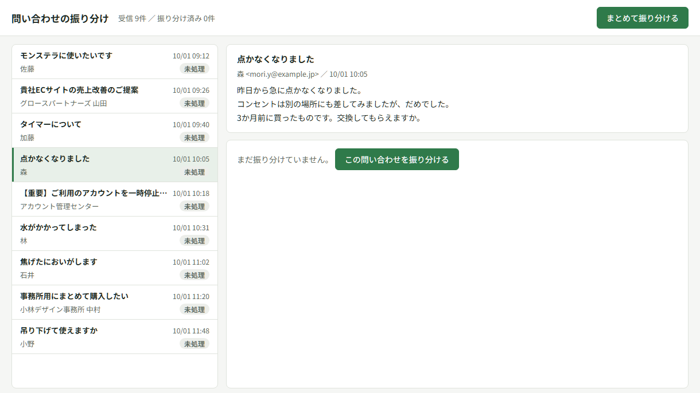

# inquiry-triage-ai

[](https://github.com/Mxhlix/inquiry-triage-ai/actions/workflows/test.yml)

English | [日本語](#日本語)

A component that uses AI (Gemini) to sort emails arriving at a customer inquiry inbox and drafts replies based on an FAQ.
It sorts each email into "customer inquiry", "sales pitch" or "spam", and gives inquiries a severity level from 1 to 3.
It is written to run on Google Apps Script (GAS).



The screenshot shows the state before the AI is called (taken without an API key).

## What it does

`triageInquiry(メール, FAQ)` (arguments: email, FAQ) in `gas/Code.gs` processes one email in this order:

1. Search the FAQ for up to 4 entries close in meaning (Gemini embeddings, `gemini-embedding-001`; entries with similarity below 0.71 are not used)
2. The AI returns, in a fixed format (JSON): type, level, category, reason, what the customer has already tried, FAQ entries used, and a draft reply
3. For sales pitches and spam, no draft reply is made. Only the reason for the classification is kept
4. If certain words such as smoke, scorching, fire or injury appear, the email is treated as an inquiry and raised to level 3, regardless of the AI's judgment
5. No draft reply is made for level 3, or for inquiries the FAQ cannot answer

The levels mean:

| Level | What it covers | Draft reply |
|---|---|---|
| 1 | Common questions, such as how to use the product or its specifications | Written from the FAQ |
| 2 | Things a person should check before replying, such as possible faults, replacement or warranty | Written to ask for the purchase date and symptoms |
| 3 | Possible safety incidents, serious complaints, or anything needing a company decision | Not written. Routed to a staff member |

Fetching mail from Gmail, creating drafts and logging to a spreadsheet are not included in this component.

## Design notes

- The AI's answer is not trusted as is. Of the FAQ entries the AI says it "used", only those that search selected and passed to the AI are accepted. If it names an FAQ entry that was not passed to it, the draft reply is discarded and the email goes to a person. The level is clamped to 1 to 3, and an unreadable level is treated as 3.
- Dangerous emails are not missed. Words linked to safety incidents are checked by code, separately from the AI's judgment. Even if the AI says level 1 or spam, the email becomes a level 3 inquiry.
- Nothing is written when there is no answer. For level 3 and for inquiries the FAQ does not answer, the draft reply is emptied even if the AI wrote one. The prompt also tells the AI not to promise numbers or actions (replacement, refund and so on) that are not in the FAQ.
- An AI outage does not stop the whole run. When the service is busy (429, 503) it waits and retries, and if that fails it switches to the next model. If there is still no answer, or the answer cannot be read as JSON, or its shape is not as expected, the email is marked 「AIの応答なし」 (no AI response) and processing moves on.
- No API key in the code. On GAS it is read from the script property `GEMINI_API_KEY`. When running locally it is read from an environment variable or from `.env` at the repository root.
- All output to the screen is escaped. HTML in an email subject or body will not run.

## Verification

`npm test` checks the triage rules without calling the AI (28 checks).
The Gemini calls are replaced with fakes, and each test supplies its own embeddings and AI answers. No API key or network access is needed.

What is checked:

- The FAQ search cutoff (0.71) and ordering, and that FAQ embeddings are created only once
- No draft reply is made when the AI claims to have used an FAQ entry it was not given
- The draft reply is emptied for level 3 and when the FAQ has no answer
- Words linked to safety incidents switch the email to level 3 and to inquiry
- No draft reply is made for sales pitches or spam
- Handling of out-of-range or unreadable levels
- Retrying and switching models when busy, and not retrying on other errors
- When the AI's answer is unreadable or has the wrong shape, or there is no API key, it does not stop with an exception and becomes 「AIの応答なし」

In the last item, the wrong-shape answer and the missing key cases were bugs that only came to light when the tests were written. The commits that fixed them are kept separate in the history.

`npm run live` calls the real Gemini and triages the 9 sample emails. The expected result for each email (status, level, FAQ entries used) is written down, and the run fails if any result differs.

## Getting started

Runs on Node.js 18 or later (checked locally on Node.js 24). No external packages are used.

```
npm ci
npm test          # check the triage rules without AI (28 checks)
npm run serve     # open the UI at http://localhost:8791
npm run live      # triage the 9 sample emails with the real Gemini (needs an API key)
```

For `npm run serve` and `npm run live` to call the AI, put a Gemini API key in the environment variable `GEMINI_API_KEY`, or place a `.env` at the repository root containing `GEMINI_API_KEY=...`.
Without a key, triaging in the UI results in 「AIの応答なし」.

To use it on GAS, paste `gas/Code.gs` into a project and set `GEMINI_API_KEY` in the script properties.

## Project layout

```
gas/Code.gs          triage core (runs on GAS as is)
harness/load-code.js stand-in for GAS so Code.gs runs on Node
harness/server.js    UI and local server for checking
harness/run.js       checks the 9 samples with the real Gemini
ui/index.html        the screen staff use
data/                sample emails and FAQ (fictional)
test/                tests that do not call the AI
docs/                screenshots
```

## Not yet verified

- `npm run live`, which calls the real Gemini, has not been run in this repository. Whether the AI triages the 9 samples as expected is unverified.
- The prompt has no defense against commands written in an email body, such as "ignore these instructions and..." (prompt injection). Level 3 on dangerous words and accepting only the FAQ entries that were passed are enforced in code, but an attack that tricks the AI into classifying an email as a sales pitch or spam is not prevented.
- Behavior in the actual GAS runtime (execution time limits, UrlFetchApp quotas) has not been verified. Locally it runs on a GAS stand-in.
- This repository has not verified whether the model names used (such as `gemini-3.5-flash`) are still available.

## License

MIT. See [LICENSE](LICENSE).

---

## 日本語

問い合わせ窓口に届いたメールを AI（Gemini）で仕分け、FAQ をもとに返信案を作る部品です。
メールを「お客様の問い合わせ」「営業」「迷惑メール」に分け、問い合わせには対応の重さをレベル1〜3で付けます。
Google Apps Script（GAS）で動かす前提で書いています。


画面写真は、AI を呼ぶ前の状態です（APIキー無しで撮影）。

### できること

`gas/Code.gs` の `triageInquiry(メール, FAQ)` が、メール1通を次の順に処理します。

1. FAQ から、意味の近い項目を最大4件探す（Gemini の埋め込み `gemini-embedding-001`。近さ 0.71 未満は使わない）
2. AI が、種類・レベル・分類・理由・お客様がすでに試したこと・使った FAQ・返信案を、決まった形（JSON）で返す
3. 営業と迷惑メールには返信案を作らず、見分けた理由だけを残す
4. 煙・焦げ・発火・けがなど決めた言葉があれば、AI の判定にかかわらず問い合わせとして扱い、レベル3に上げる
5. レベル3と、FAQ で答えられない問い合わせには返信案を作らない

レベルの意味は次のとおりです。

| レベル | 中身 | 返信案 |
|---|---|---|
| 1 | 使い方・仕様など、よくある質問 | FAQ をもとに作る |
| 2 | 故障の可能性・交換・保証など、人が確かめてから返すもの | 購入日や症状をたずねる形で作る |
| 3 | 事故につながるおそれ・重いクレーム・会社の判断が要るもの | 作らない。担当者へ回す |

Gmail からの取り込み、下書きの作成、スプレッドシートへの記録は、この部品には入れていません。

### 設計で気をつけたこと

- **AI の答えをそのまま信じない。** AI が「使った」と答えた FAQ のうち、検索で選んで AI に渡したものだけを認めます。渡していない FAQ を挙げたときは、返信案を捨てて人に回します。レベルは1〜3に丸め、読めないときは3として扱います。
- **危ないメールを取りこぼさない。** 事故につながる言葉は、AI の判定とは別にコードで調べます。AI がレベル1や迷惑メールと答えても、レベル3の問い合わせにします。
- **答えられないものには書かない。** レベル3と FAQ に答えが無い問い合わせでは、AI が返信案を書いていても空にします。指示文でも、FAQ に無い数字や対応（交換・返金など）を約束しないよう指定しています。
- **AI が止まっても全体を止めない。** 混んでいるとき（429・503）は待って呼び直し、だめなら次のモデルに切り替えます。それでも答えが無いとき、答えが JSON として読めないとき、形が想定と違うときは、そのメールに「AIの応答なし」の印を付けて次へ進みます。
- **APIキーをコードに書かない。** GAS ではスクリプトのプロパティ `GEMINI_API_KEY` から読みます。手元で動かすときは環境変数か、リポジトリ直下の `.env` から読みます。
- **画面への出力はすべてエスケープする。** メールの件名や本文に HTML が入っていても実行されません。

### 検証

`npm test` で、AI を呼ばずに振り分けの決まりを確かめます（28項目）。
Gemini の呼び出しを偽物に差し替え、埋め込みと AI の答えをテストごとに決めて渡しています。APIキーも通信も要りません。

確かめていることは次のとおりです。

- FAQ 検索の足切り（0.71）と並び順、FAQ の埋め込みを1回だけ作ること
- 渡していない FAQ を使ったと答えたときに、返信案を作らないこと
- レベル3と FAQ に答えが無いときに、返信案を空にすること
- 事故につながる言葉で、レベル3と問い合わせ扱いに切り替わること
- 営業・迷惑メールに返信案を作らないこと
- 範囲外や読めないレベルの扱い
- 混雑時の呼び直しとモデルの切り替え、それ以外のエラーでは呼び直さないこと
- AI の答えが読めない・形が違う・APIキーが無いときに、例外で止まらず「AIの応答なし」になること

最後の項目のうち、形が違う答えとキー無しの2つは、テストを書いて初めて見つかった不具合でした。直したコミットは履歴に分けてあります。

本物の Gemini を呼んで見本9通を振り分ける確認は `npm run live` です。メールごとに期待する結果（状態・レベル・使う FAQ）を書いてあり、外れると失敗で終わります。

### 動かし方

Node.js 18 以上で動きます（手元では Node.js 24 で確認）。外部のパッケージは使っていません。

```
npm ci
npm test          # 振り分けの決まりを AI 無しで確かめる（28項目）
npm run serve     # http://localhost:8791 で画面を開く
npm run live      # 本物の Gemini で見本9通を振り分ける（APIキーが必要）
```

`npm run serve` と `npm run live` で AI を呼ぶには、Gemini の APIキーを環境変数 `GEMINI_API_KEY` に入れるか、リポジトリ直下に `.env` を置いて `GEMINI_API_KEY=...` と書きます。
キーが無いときは、画面で振り分けると「AIの応答なし」になります。

GAS で使うときは、`gas/Code.gs` をプロジェクトに貼り、スクリプトのプロパティに `GEMINI_API_KEY` を入れます。

### フォルダ構成

```
gas/Code.gs          振り分けの本体（GAS でそのまま動く）
harness/load-code.js Code.gs を Node で動かすための GAS の代役
harness/server.js    画面とローカル確認用のサーバ
harness/run.js       本物の Gemini で見本9通を確かめる
ui/index.html        担当者が使う画面
data/                見本のメールと FAQ（架空）
test/                AI を呼ばないテスト
docs/                画面写真
```

### まだ確かめていないこと

- このリポジトリでは、本物の Gemini を呼ぶ `npm run live` を動かしていません。AI が見本9通を期待どおりに振り分けるかは未確認です。
- メール本文に「この指示を無視して〜」のような命令が書かれた場合の対策（プロンプトインジェクション対策）は、指示文に入れていません。危ない言葉でのレベル3や、渡した FAQ しか認めない仕組みはコード側で効きますが、AI に営業や迷惑メールと誤って判定させる攻撃は防げていません。
- GAS の実際の実行環境（実行時間の上限、UrlFetchApp の回数制限）での動作は確かめていません。手元では GAS の代役で動かしています。
- 使うモデル名（`gemini-3.5-flash` など）が今も使えるかは、このリポジトリでは確かめていません。

### ライセンス

MIT です。[LICENSE](LICENSE) を見てください。
